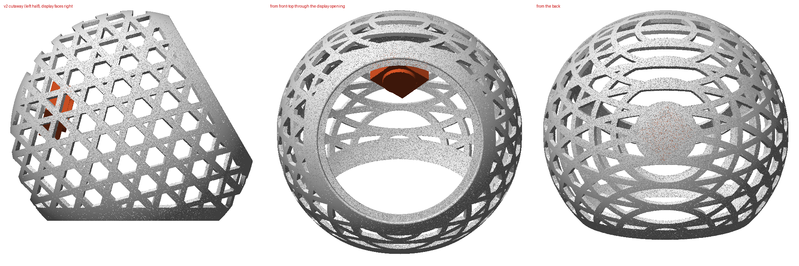
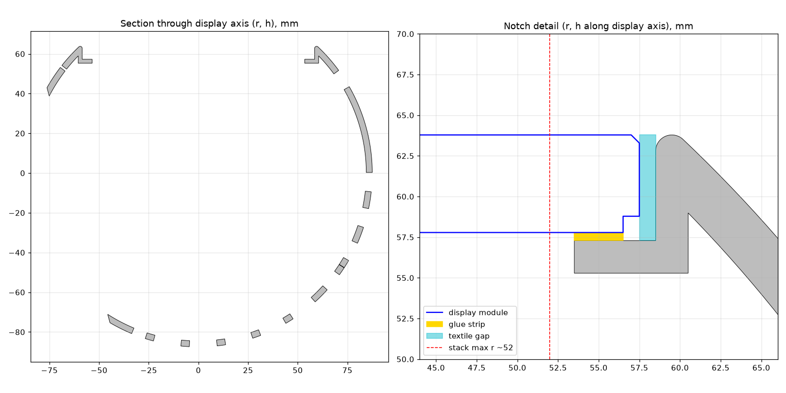
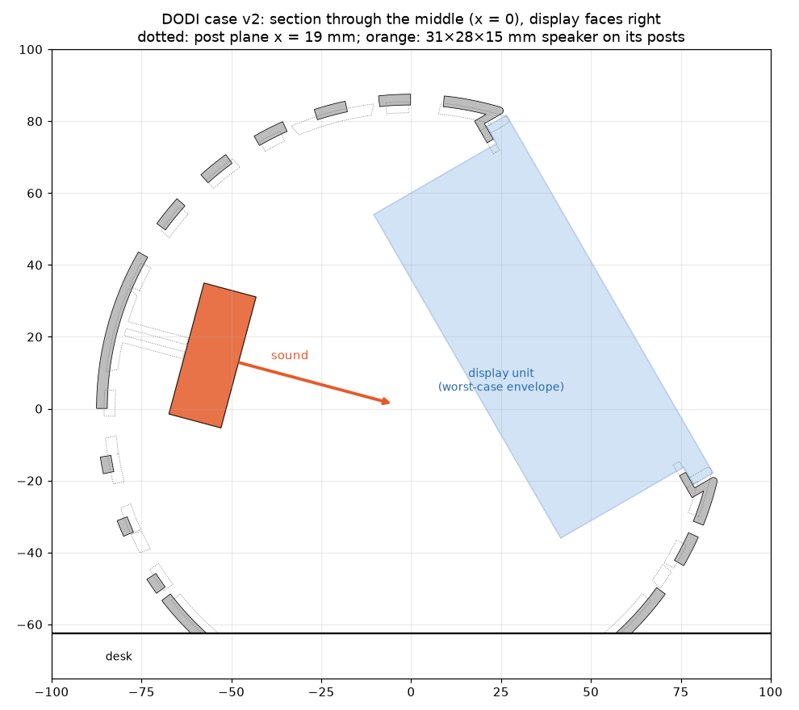
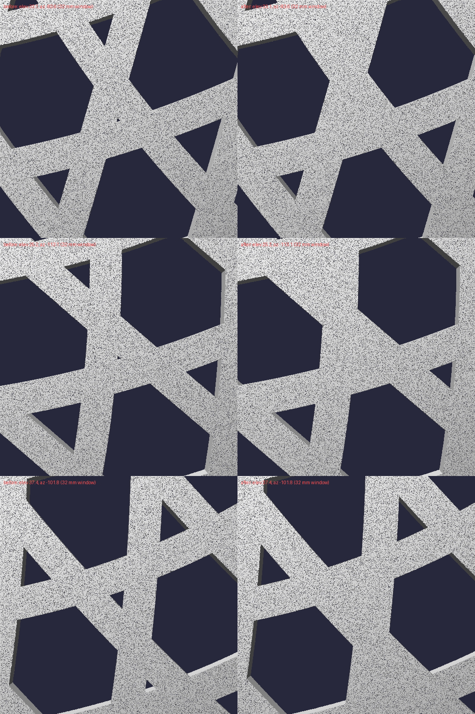

# DODI Hardware Specification

Reference for the physical build of DODI: components, how they connect, how the
OS is configured to drive them, and the hardware quirks the software works around.

Values marked **(measured)** were read from the running device on 2026-10-14.
Everything else comes from the component datasheets, the boot configuration, or
the enclosure generators in [`case/`](case/).

---

## 1. Bill of materials

| # | Component | Part | Role |
|---|-----------|------|------|
| 1 | Single-board computer | Raspberry Pi 4 Model B, **8 GB**, Rev 1.5 | Runs DODI |
| 2 | Audio HAT | Seeed Studio **ReSpeaker 2-Mics Pi HAT** (v1.x, WM8960 codec) | 2 mics + speaker amplifier |
| 3 | Display | Waveshare **3.4" DSI Round Touch Display (C)**, 800×800 | Avatar, clock, settings UI, all user input |
| 4 | Speaker | Small full-range driver, 31 mm cone, 44 mm diagonal incl. mounting ears | Voice and alarm playback |
| 5 | Storage | microSD, 256 GB class (238.4 GB usable) | OS + app |
| 6 | Enclosure | 3D-printed mesh sphere (see [§9](#9-enclosure)) inside a plush cover | Housing |
| 7 | Power supply | USB-C into the Pi 4 | See [§8](#8-power-and-thermal) |
| 8 | Network | On-board Wi-Fi and/or Gigabit Ethernet | Cloud AI, weather, NTP |

---

## 2. Compute: Raspberry Pi 4 Model B

| Property | Value |
|----------|-------|
| Model string | `Raspberry Pi 4 Model B Rev 1.5` **(measured)** |
| Revision code | `d03115` (8 GB, BCM2711, Pi 4B, rev 1.5) **(measured)** |
| SoC | Broadcom BCM2711, 4× Cortex-A72 (ARMv8, 64-bit) |
| CPU clock | 1.8 GHz max (`arm_freq=1800`, `arm_boost=1`) **(measured)** |
| RAM | 8 GB LPDDR4 (7.6 GiB visible to Linux; 948 MB ARM / 76 MB GPU split in firmware) **(measured)** |
| Swap | 2 GB zram (compressed RAM, no SD wear) **(measured)** |
| CPU governor | `ondemand` by default; DODI pins `performance` while audio is playing (see [§10](#10-hardware-quirks-handled-in-software)) |
| USB controller | VIA Labs VL805 (`2109:3431`); no USB devices attached **(measured)** |
| Firmware | VideoCore firmware build of 2025-08-20 **(measured)** |

### Operating system **(measured)**

| Item | Value |
|------|-------|
| Distribution | Raspberry Pi OS based on Debian 13 "trixie", 64-bit (`arm_64bit=1`) |
| Kernel | `6.12.62+rpt-rpi-v8` (aarch64, PREEMPT) |
| Partitions | `mmcblk0p1` 512 MB `/boot/firmware` (FAT), `mmcblk0p2` 237.9 GB `/` (ext4) |
| Service | `dodi.service` (systemd, `User=pi`, starts on boot) |

---

## 3. Display: Waveshare 3.4" DSI Round Touch Display (C)

| Property | Value |
|----------|-------|
| Resolution | 800 × 800, round, reported mode `800x800` on `DSI-1` **(measured)** |
| Active (visible) area | Ø 87.6 mm |
| Module outer diameter | Ø 115 mm including the black bezel |
| Interface | MIPI DSI ribbon into the Pi's DSI connector |
| Driver | KMS: `vc4-kms-v3d` + `vc4-kms-dsi-waveshare-panel,3_4_inch` |
| Panel controller | I²C `10-0045` (`3.4inch-panel`), also exposes the backlight **(measured)** |
| Backlight | `/sys/class/backlight/10-0045/`, `brightness` 0–255 **(measured)** |
| Touch controller | Goodix **GT911** at I²C `10-0014`, input device "Goodix Capacitive TouchScreen" **(measured)** |
| Touch | Capacitive multi-touch, ≥ 3 simultaneous touches verified under SDL KMSDRM |
| Rendering | pygame 2.6 / SDL2 on KMSDRM (no X/Wayland) |

**Overlay choice matters.** Use the **v1** overlay
`vc4-kms-dsi-waveshare-panel,3_4_inch`. The v2 overlay
(`vc4-kms-dsi-waveshare-panel-v2,3_4_inch_c`) gives a black screen on this
hardware: the panel MCU answers over I²C, but the DSI link floods
`DSI1: LP1 contention error` and no image reaches the panel.

### Touch gestures used by DODI

| Gesture | Action |
|---------|--------|
| Double-tap | Toggle deaf ↔ normal (live conversation) mode |
| Single-finger left swipe | Info screen (time, weather, CPU temperature) |
| Two-finger swipe down (on the avatar) | Alarm settings |
| Single-finger drag | Alarm time dial |
| Tap | Dismiss a ringing alarm |

DODI is touch-only. The HAT's user button (GPIO17) is unused; it is the fallback
input if touch ever regresses.

---

## 4. Audio: Seeed ReSpeaker 2-Mics Pi HAT

| Property | Value |
|----------|-------|
| Codec | Wolfson/Cirrus **WM8960**, I²C `1-001a` (bound to the kernel driver) **(measured)** |
| Digital audio | I²S (`dtparam=i2s=on`, `dtoverlay=i2s-mmap`) |
| Driver | `seeed-2mic-voicecard` overlay + out-of-tree `snd_soc_seeed_voicecard` kernel module |
| ALSA card | **card 0** `seeed2micvoicec` (playback + capture) **(measured)** |
| Microphones | 2 on-board mics (left/right) |
| Mic capture | 16 kHz, mono, opened **by name** (`seeed-2mic-voicecard`) via PyAudio |
| Speaker output | JST 2.0 "SPEAKER" connector, driven by the WM8960 class-D amp (datasheet: 1 W/channel into 8 Ω) |
| Headset jack | 3.5 mm "HEADSET" (unused) |
| Mixer control used | `Speaker` (0–127), used as a binary hardware mute gate |
| Volume | Software gain: `audio.volume` (conversation) and `alarm.volume`, both in `settings.json` |
| Unused HAT features | 3× APA102 RGB LEDs (SPI, which is disabled), user button (GPIO17), Grove `GP12` and `I2C` ports, micro-USB power input |

### Other ALSA cards **(measured)**

| Card | Device | Used? |
|------|--------|-------|
| 0 | `seeed2micvoicec` (WM8960) | **Yes**, all audio in and out |
| 1 | `bcm2835 Headphones` (Pi 3.5 mm jack) | No; nothing is connected |
| 2, 3 | `vc4-hdmi-0/1` | No |

Never hard-code card indices (e.g. `plughw:1,0` is the unconnected Pi jack).
Playback uses `sounddevice`'s default output, which routes to card 0, and
capture resolves the device by name.

---

## 5. Speaker

| Property | Value |
|----------|-------|
| Type | Boxed (sealed-back) full-range module, 31 × 28 × 15 mm body |
| Front | Cone on the 31 × 28 mm face; ears on two diagonal corners |
| Frame | 44 mm diagonal incl. mounting ears, 2 diagonal screw holes ~38 mm apart |
| Mounting | 2× M2.5 screws through the ears (flush with the box back) into case posts: inside top (v1) or upper back (v2) |
| Connection | 2-wire lead (16 cm) to the HAT's JST 2.0 `SPEAKER` port |
| Impedance / power | Not documented; the WM8960 amp is rated 1 W/channel into 8 Ω |

---

## 6. Networking

| Interface | Hardware | Notes |
|-----------|----------|-------|
| `eth0` | On-board Gigabit Ethernet (BCM54213PE PHY) | Preferred link inside the plush; the jack LEDs are disabled |
| `wlan0` | Infineon/Cypress CYW43455, 802.11ac 2.4 + 5 GHz | Managed by NetworkManager (`nmcli`); night mode powers the radio off/on on schedule |
| Bluetooth | Same chip (BCM4345C0), BT 5.0 | Unused; `hci0` is soft-blocked **(measured)** |
| `tailscale0` | VPN | Remote administration |

The weather service treats *any* default route (Ethernet or Wi-Fi) as online
(`src/network/connectivity.py`).

---

## 7. Bus and pin map

### I²C **(measured)**

| Bus | Address | Device |
|-----|---------|--------|
| `i2c-1` (GPIO2/3, header) | `0x1a` | WM8960 codec (HAT) |
| `i2c-10` (DSI/CSI mux, ch. 1) | `0x14` | GT911 touch controller |
| `i2c-10` | `0x45` | Waveshare panel MCU / backlight |

### GPIO header (40-pin, fully covered by the HAT)

| Function | Pins | Used by DODI |
|----------|------|--------------|
| I²S (BCLK/LRCLK/DIN/DOUT) | GPIO18–21 | Yes, audio |
| I²C1 (SDA/SCL) | GPIO2/3 | Yes, codec control |
| SPI0 | GPIO10/11 (+CE) | No; APA102 LEDs, SPI is disabled |
| User button | GPIO17 | No; fallback input (currently input, pull-down) **(measured)** |
| Grove GP12 | GPIO12/13 | No |
| UART | GPIO14/15 | `enable_uart=1` (serial console available) |

---

## 8. Power and thermal

| Property | Value |
|----------|-------|
| Input | USB-C 5 V into the Pi; powers the HAT and display through the header/DSI |
| Recommended PSU | Official Raspberry Pi 15 W (5.1 V / 3 A) USB-C supply |
| Under-voltage / throttling | `get_throttled=0x0`: no under-voltage, no throttling since boot **(measured)** |
| Core voltage | 0.926 V (AVS-managed) **(measured)** |
| CPU temperature | 50.6 °C, idle, ~18 min after boot, inside the plush **(measured)** |
| Firmware throttling | Pi 4 starts throttling the ARM at 80 °C (fully at 85 °C) |
| Cooling | Passive only: no fan; the open mesh-sphere case provides airflow behind the plush fabric |
| Heat reduction | `ondemand` governor at idle; screen dimmed (night mode, brightness 10) or off; Wi-Fi radio off at night |

The info screen shows a live CPU-temperature gauge (from `src/sensors/cpu_temp.py`)
with warm/hot thresholds, so overheating in the plush is visible on the device.

### Status LEDs

Everything that can be disabled in software is disabled in
`/boot/firmware/config.txt` (and written idempotently by `scripts/install.sh`):

| LED | Location | State | How |
|-----|----------|-------|-----|
| ACT (green) | Pi board | Off | `dtparam=act_led_trigger=none`, `act_led_activelow=off` |
| PWR (red) | Pi board | Off (Linux reports `brightness=0`) | `dtparam=pwr_led_trigger=none`, `pwr_led_activelow=off` |
| Ethernet jack LEDs (green/amber) | RJ45 | Off (verified after reboot) | `dtparam=eth_led0=4`, `eth_led1=4` |
| Power LED (green) | Waveshare display driver board | **On, hard-wired** | No software control; cover with opaque tape if needed |
| Red LED | Near the HAT's I²C/micro-USB corner | **On** | Source not yet confirmed (HAT or Pi PWR LED); open item |

---

## 9. Enclosure

Both versions are generated parametrically by scripts in [`case/`](case/).



| Parameter | v1 (prototype 1, printed in SLS PA12) | v2 (prototype 2) |
|-----------|---------------------------------------|------------------|
| Files | [`generate_case.py`](case/generate_case.py) → [`case.obj`](case/case.obj) | [`generate_case_v2.py`](case/generate_case_v2.py) → [`case_v2.obj`](case/case_v2.obj) / [`case_v2.stl`](case/case_v2.stl) |
| Shape | Sphere, Ø 175 mm (R 87.5 mm), flat-cut base | same |
| Wall | 3.0 mm, diamond wire-frame mesh (3 line families at 0°/±60°, 12° spacing) | same pattern, exact CSG (smooth edges instead of v1's 0.35 mm stair-steps), hairline slits closed |
| Height | 150 mm (base cut 25 mm above the bottom pole) | same |
| Display tilt | 15° above horizontal | **30°** (base cut 15° further back) |
| Display mount | Plain Ø 113 mm hole; display could not be fixed in place | **Glue-in notch** |
| Pi mounting | 4× M2.5 standoffs on the back wall | **None**: the Pi is stacked on the display's M2.5×8 studs |
| Speaker mounting | 2× M2.5 posts at the inside top (65 mm from the centre), 38 mm apart | **Same posts on the filled upper-back disc** |
| Solid areas | 10° top cap | Top open (lattice chimney); upper-back disc filled (Ø ≈ 45 mm) |
| Mesh | ~1.0 M faces, overlapping bodies | 288 k triangles, single watertight 2-manifold body, 137 cm³ |
| Cover | Plush fabric over the printed sphere | same |

```bash
pip install manifold3d numpy scipy
python hardware/case/generate_case_v2.py --fabric-gap 1.0 --glue 0.5 [--fit-test 0.8 1.2]
```

### Display notch



Section through the display axis (h = distance from the sphere centre along the
display axis). The display module dimensions come from Waveshare's STEP model of
the 3.4inch DSI LCD (C): Ø 115.0 rim (4.5 mm + 0.5 mm front chamfer) and a
Ø 113.0 × 1.0 mm back plate, 6.0 mm from glass face to back plate.

| Feature | Value | Parameter |
|---------|-------|-----------|
| Notch wall inner Ø | 117.0 mm (1.0 mm per side for textile + hot glue) | `FABRIC_GAP` |
| Notch wall thickness | 2.0 mm | `NOTCH_WALL_T` |
| Ledge | 2.0 mm thick, opening Ø 107 mm, a 3.0 mm glue land under the display's back plate (r 53.5–56.5 mm) | `LEDGE_T`, `LEDGE_INNER_R` |
| Glue strip allowance | 0.5 mm | `GLUE_T` |
| Glass position | Flush with the top of the rounded lip (fabric ends up ~1 mm proud, protecting the glass) | `DISPLAY_RECESS` |
| Lip | 1.0 mm radius, so the fabric wraps over a rounded edge | `LIP_FILLET` |

The ledge opening (r = 53.5 mm) is sized so the whole display unit (driver PCB
r ≤ 50.1 mm, Pi + USB/Ethernet ≈ 52 mm, HAT) drops in from the front. Don't
shrink it below ~53 mm.

**Fit test first.** `fit_test_ring_gap{0.6,1.0,1.4}.stl` are cheap rings (≈ 16 cm³
each) containing only the lip, wall and ledge, at three fabric gaps. Print them
with the same process, glue your fabric in, and press the display in. Then
regenerate the case with the gap that gave a firm (not loose) fit.

### 30° display tilt

The flat base is cut 15° further back than in v1 (`BASE_ROLL_DEG`). Standing on
a desk, the display faces 30° above horizontal instead of 15°, which suits a
seated desk user (~40° sight line), someone in bed (~10–20°) and tapping from
above. Only the base plane moves, so notch, display unit and speaker keep their
positions relative to each other.

| Check (standing) | Value |
|------------------|-------|
| Screen centre height | 94 mm above the desk (v1: 79 mm) |
| Base contact | Flat ring, Ø 122.6 mm |
| Lowest notch point / display unit | 38 mm / 26 mm above the desk |
| Centre of mass (shell + ~230 g display unit, est.) | ~20 mm forward of the base centre, base radius 61 mm |

### Speaker on the upper back, open top



| Item | v2 |
|------|----|
| Speaker posts | v1's 2× Ø 6 mm M2.5 posts (38 mm apart, 18.3 mm long, mounting face 65 mm from the centre), rotated onto the filled upper-back disc and perpendicular to it |
| Speaker | Back face on the posts, cone facing forward into the case (15° below horizontal when standing) |
| Clearance (checked) | Speaker vs. case: none; vs. worst-case display unit (r ≤ 52 mm): none, > 30 mm gap |
| Top | No cap fill: open lattice acts as a chimney for warm air |
| Cable | ≈ 85 mm from the HAT's JST port to the speaker; the 16 cm lead reaches |

Mic echo isn't a concern with the speaker inside the case: the app mutes the
mic while Dodi speaks (`main.py` echo guard plus a 0.5 s cooldown).

### No hairline slits

Three families of overlapping circles always cross at grazing angles somewhere,
leaving slivers of 0.3–1.5 mm that read as air gaps and print poorly (v1 had
~34 of them). The generator rasterises the lattice on two cube maps, finds every
opening that is narrower than `SLIT_FILL_MM` (1.5 mm) along its whole length,
and closes it with small patches. It also widens the bands by 0.05–0.15° per
family so that bands meeting edge-to-edge overlap instead of touching.



### Assembly

1. Screw the speaker onto its posts (cone facing forward) through the display
   opening.
2. Wrap the textile over the lip and down the notch wall, hot-gluing it to the
   wall. Trim it at the ledge corner; the ledge itself must stay bare for the
   glue strip.
3. Lay 3 mm-wide adhesive strips (0.5 mm thick, e.g. double-sided foam/VHB tape)
   on the ledge.
4. Plug the DSI ribbon and the speaker lead into the display unit (display +
   driver board + Pi + HAT), then press it in from the front until the back
   plate seats on the glue strips.
5. Connect power (and Ethernet) through the bottom opening.

---

## 10. Hardware quirks handled in software

| Quirk | Symptom | Handling |
|-------|---------|----------|
| WM8960 open/close transient | Audible "pop" whenever the ALSA stream opens or closes | Mute the `Speaker` mixer around every open/close; when idle the stream is **closed and muted** (`src/audio/speaker_mute.py`, `output.py`) |
| CPU frequency drops during playback | One-off audio dropout a few seconds in (1.8 GHz → 700 MHz transition) | Pin the `performance` governor while audio plays, refcounted (`src/audio/cpu_governor.py`) |
| Chunked `sd.play` calls | Badly degraded playback | Always feed one buffer or a persistent stream; never chunk per call |
| Panel `brightness=0` | Panel enters power-save; non-zero brightness alone doesn't wake it | Toggle `bl_power` 1→0 to wake; `install.sh` installs a udev rule making `bl_power` writable by group `video` |
| pygame on Python 3.13 arm64 | Built from source; fonts are silently missing without `libsdl2-ttf-dev` → blank clock | `install.sh` installs the dev package and rebuilds pygame if `pygame.font` is missing |
| DSI overlay v2 | Black screen | Use the v1 overlay (see [§3](#3-display-waveshare-34-dsi-round-touch-display-c)) |
| ALSA card order | Card 1 is the unconnected Pi jack | Resolve devices by name or via the default device, never by index |

---

## 11. Boot configuration

Hardware-relevant lines in `/boot/firmware/config.txt` **(measured)**:

```ini
dtparam=i2c_arm=on
dtparam=i2s=on
dtparam=audio=on
dtoverlay=vc4-kms-v3d
arm_64bit=1
arm_boost=1
enable_uart=1

# ReSpeaker 2-Mics HAT (WM8960)
dtoverlay=seeed-2mic-voicecard
dtoverlay=i2s-mmap

# Waveshare 3.4inch DSI Round Touch Display (800x800); v1 overlay
dtoverlay=vc4-kms-dsi-waveshare-panel,3_4_inch

# DODI: disable onboard LEDs
dtparam=act_led_trigger=none
dtparam=act_led_activelow=off
dtparam=pwr_led_trigger=none
dtparam=pwr_led_activelow=off

# DODI: disable Ethernet jack LEDs
dtparam=eth_led0=4
dtparam=eth_led1=4
```

---

## 12. Verifying a build

```bash
cat /proc/device-tree/model; echo        # Pi model
free -h                                  # RAM
aplay -l; arecord -l                     # seeed2micvoicec must be card 0
ls /sys/bus/i2c/devices/                 # expect 1-001a, 10-0014, 10-0045
cat /sys/class/backlight/10-0045/brightness
grep -i goodix /proc/bus/input/devices   # touch controller present
vcgencmd measure_temp; vcgencmd get_throttled   # thermal / power health (0x0 = OK)
systemctl status dodi.service
```
